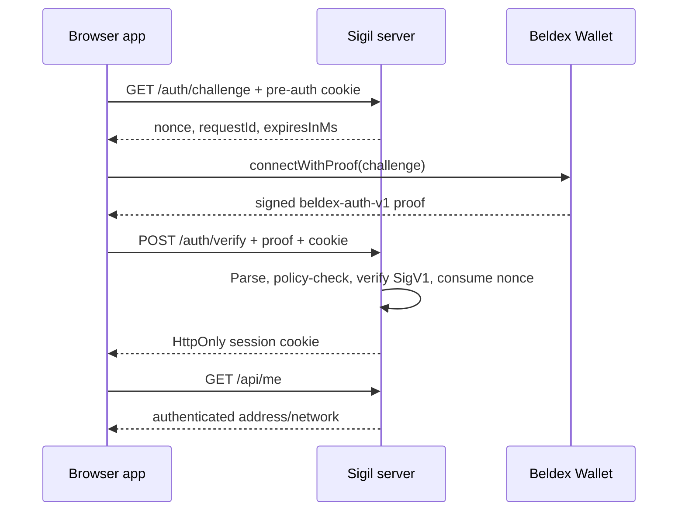

# Sigil — Sign in with Beldex

Sigil is an open-source TypeScript authentication project for applications that verify control of a Beldex address using the wallet-generated, origin-bound `beldex-auth-v1` proof.

This repository contains a Node.js SigV1 verifier, strict statement parser, server challenge/session POC, and browser demo. A local testnet sign-in was observed, but its raw wallet proof and reproducible recording are not retained here.

## Capabilities

- Independently verifies Beldex `SigV1` signatures in Node.js, using code derived from the Beldex Wallet extension.
- Parses the exact `beldex-auth-v1` statement and validates configured origin, address/network, timestamps, and challenge context.
- Issues server-generated, context-bound, single-use challenges.
- Provides a minimal Hono reference server with opaque sessions and a protected `/api/me` endpoint.
- Demonstrates browser integration through the official `@bdxi/web3js` SDK and its `connectWithProof()` flow.

The proof reveals the Beldex address. Sigil does **not** provide anonymity, unlinkability across services reusing an address, balance/holding proofs, or zero-knowledge credentials. See [privacy boundaries](docs/security/privacy.md).

## Architecture

```mermaid
flowchart LR
  Browser[Browser app] --> SDK[@bdxi/web3js]
  SDK --> Wallet[Beldex Wallet]
  Browser -->|challenge / proof| Server[Sigil Hono server]
  Server --> Parser[Strict auth parser]
  Server --> Verifier[Node SigV1 verifier]
  Server --> Nonces[(Memory nonce store)]
  Server --> Sessions[(Memory session store)]
```



The reference server and memory stores are a single-process POC, not a production deployment.

## Repository layout

```text
apps/poc-server/       Hono challenge, verification, and session endpoints
apps/poc-web/          Browser reference app using @bdxi/web3js
packages/core/         SigV1 verifier, statement parser, and memory stores
tests/                 Unit and server integration tests
docs/architecture/     Architecture and trust boundaries
docs/research/         Upstream protocol, verifier, BNS, and compatibility notes
docs/security/         Privacy and security boundaries
```

## Run the local POC

Requirements: Node.js 20+ and npm.

```sh
npm ci
npm run dev:server
```

In a second terminal:

```sh
npm run dev:web
```

Open `http://localhost:5173`. The reference server defaults to `testnet` and this localhost origin. With a compatible Beldex Wallet extension unlocked on testnet, the app requests a challenge, calls `connectWithProof()`, submits the returned proof, and checks `/api/me`.

The key browser calls are:

```ts
const challenge = await fetch("/auth/challenge", {
  credentials: "include",
}).then((response) => response.json());

const { proof } = await bdx.connectWithProof({ challenge });
if (!proof) throw new Error("Wallet did not provide an authentication proof");

const verified = await fetch("/auth/verify", {
  method: "POST",
  credentials: "include",
  headers: { "Content-Type": "application/json" },
  body: JSON.stringify(proof),
});
if (!verified.ok) throw new Error("Authentication failed");

const me = await fetch("/api/me", { credentials: "include" }).then((r) =>
  r.json(),
);
```

Server configuration defaults and supported environment variables are documented in [Configuration](docs/getting-started/configuration.md). The complete endpoint contract is in the [HTTP API reference](docs/api/http.md).

The POC nonce and session stores are in-memory and single-process; state is lost on restart. Do not use this setup for production or multiple server instances. Outside localhost, use HTTPS and set `COOKIE_SECURE=true`. Never request or share a seed phrase, private key, or view key.

## Development checks

```sh
npm test
npm run typecheck
npm run lint
npm run format:check
npm run build
```

Tests include upstream CLI-produced SigV1 fixtures and deterministic test-only signing for server lifecycle cases. Such fixtures are not a substitute for wallet-generated proof evidence. See [verifier implementation notes](docs/research/SIGV1-VERIFIER-PORT.md), [wallet compatibility](docs/research/WALLET-COMPATIBILITY.md), [protocol reconnaissance](docs/research/BELDEX-PROTOCOL-RECONNAISSANCE.md), and [architecture](docs/architecture/overview.md).

## Contributing and security

See [CONTRIBUTING.md](CONTRIBUTING.md) and [SECURITY.md](SECURITY.md). Do not use this experimental POC to protect production accounts or assets.

## Documentation

Start at the [documentation index](docs/README.md) for tutorials, concepts, architecture, protocol details, integration examples, API references, operations, security, and upstream compatibility research.

## License

MIT. See [LICENSE](LICENSE).
