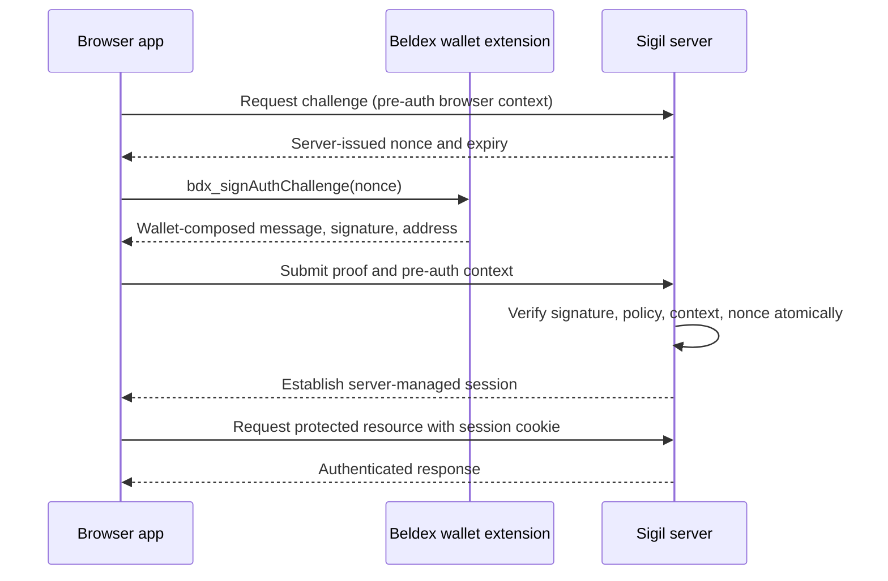

# Architecture and current boundary

## Intended flow



```mermaid
flowchart LR
  UI[Browser UI] --> SDK[@bdxi/web3js]
  SDK -->|wallet RPC| EXT[Beldex extension]
  UI -->|HTTP + cookies| API[Hono reference server]
  API --> PARSE[Strict statement parser]
  API --> VERIFY[SigV1 verifier]
  API --> CHAL[(Memory challenge store)]
  API --> SESS[(Memory session store)]
  VERIFY -->|address, exact message, signature| TRUST[Authentication decision]
  CHAL --> TRUST
```

## Trust boundaries

- Browser page state is untrusted; it cannot assert that a proof is valid.
- Wallet origin binding is meaningful only for the documented compatible wallet path.
- The relying server must independently verify signature and policy and own nonce/session state.
- Daemon-backed BNS verification is a separate dependency and must not be conflated with wallet proof verification.

## POC implementation status

There is an isolated SigV1 verifier (`packages/core/src/verifier/sigv1.ts`), strict statement parser, in-memory challenge/session stores, Hono endpoints and browser app. The verifier derives the spend public key from the address and checks exact received message bytes. The local POC reached a successful testnet `/api/me` state; raw proof evidence is not stored in this repository. Deterministic real-verifier integration tests are separate from HTTP lifecycle tests that inject a fake verifier.

Challenges are bound to a server-generated HttpOnly pre-auth cookie and server-generated request ID. The pre-auth context cookie is authenticated with a process-local HMAC key generated when `createApp` starts. Verification validates the statement and signature, checks address network prefix, atomically consumes the nonce/request ID/context tuple, then issues an opaque in-memory session cookie. The synchronous memory-store operation guarantees single-use only in this single Node process; it is not distributed/horizontally safe. Use a supported HTTPS origin in production. The local POC uses Vite's localhost origin.

No framework adapter, durable store, production security audit, or BNS verifier is implemented. The browser app calls the real Beldex SDK methods; live success is user-reported, but a recording and sanitized proof/response evidence still need capture.
